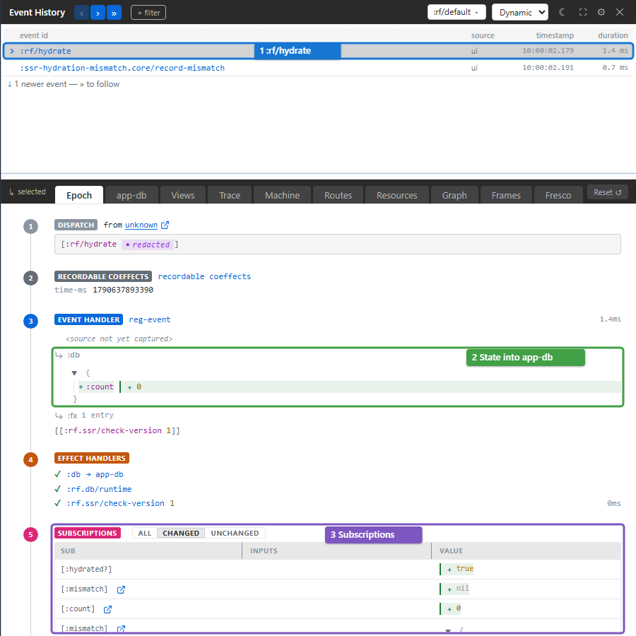

# SSR hydration

Your page was rendered on the server and now hydrates in the browser. Xray shows the hydration event itself, and keeps a hydration mismatch in its event list, where the Trace tab reads its details. This chapter says where to find it, and where else it is reported. [When the renders disagree](../ssr/concepts.md#when-the-renders-disagree) in the SSR guide explains how a mismatch is reported and what React does about it.

## The hydrate epoch

Hydration is an ordinary event. The client dispatches `:rf/hydrate`, which installs the server's state into app-db, and Xray lists it in the event list like any other event (1 in the screenshot). Its Epoch tab shows the state landing in app-db (2), the effects it ran, and the subscriptions that computed their first values (3). The app-db tab shows the state the client's first render reads.

## Where a mismatch is reported

A hydration mismatch is not an event, and it belongs to no epoch. React reports it while it hydrates the root, outside any event: when the server's markup and the client's first render diverge in a way React recovers from (different text, or a missing, extra or wrong-type element), React re-renders the root on the client and calls the root's recoverable-error callback, where re-frame emits `:rf.ssr/hydration-mismatch`.

Xray keeps it in the event list's `:ungrouped` row, which collects every trace fired outside an event. That row is hidden by default. Turn on **Show :ungrouped pseudo-event-bundle events in L2** in Settings → General, and a `<no event>` row appears, washed pink because it holds an issue.

Select that row and open the Trace tab, which lists the row's traces. Click the `:rf.ssr/hydration-mismatch` row to open the whole trace: React's own message is its `:error` tag, beside `:where`, the door that hydrated the root (`re-frame.substrate.spine/make-render` for Reagent and UIx), and the recovery React took, `:warned-and-replaced`. The Epoch tab says "The selected event settled no epoch.", because no epoch settled.

Outside Xray, the details go to:

- trace listeners, as that same trace, carrying the same tags. [Write a listener](../core/observability.md#write-a-listener) in the observability guide shows how to register one.
- error listeners and sinks, as a structural error record under the same id, naming the door and the recovery but not React's message, which in development carries app text. That record is sent in every build. [Declare a sink](../core/observability.md#consuming-production-telemetry-declare-a-sink) in the observability guide shows how.

In a development build React's message ends with a diff of the first divergence it met. React has already recovered by the time the trace fires, so the page keeps working. To fail a CI run on a mismatch, pass `:on-recoverable-error` with `{:hydrate? true}` when you mount the root, and fail the run from that callback.

This reports the recoveries React makes; it is not exhaustive. An attribute-only divergence draws React's development `console.error`, with a diff, and nothing else: React does not patch it, no trace fires, and no record is sent.

The testbed in the screenshot registers a trace listener that dispatches the mismatch report into app-db. That is why `:ssr-hydration-mismatch.core/record-mismatch` follows `:rf/hydrate` in its event list, and why the app-db tab shows React's message.

## What to look for

The server and the client rendered different HTML, so either they had different state or a view did not render the same state the same way. The usual causes:

- A view used `js/Date`, random, or browser state during render.
- Server and client seeded different app-db values.
- The route matched differently on the client.
- A subscription returned `nil` on the server and real data on the client.
- A classified value was redacted or elided before one side expected it.

Xray shows the client's side. Read the `:rf/hydrate` epoch for the state the client started from, and compare it with the state the server rendered. Fix the source of the difference; do not patch the rendered HTML afterwards.

## Troubleshooting

| Symptom | Check | Action |
| --- | --- | --- |
| `:rf/hydrate` installed the expected state but a mismatch followed | The first client render, not just app-db | Compare render inputs and nondeterministic values |
| No mismatch row is visible in Xray | Ungrouped rows are hidden | Enable the ungrouped option, select `<no event>` and open Trace |
| The mismatch's Epoch panel is empty | A mismatch occurs outside the event pipeline | Read its raw trace; it has no settled epoch |
| CI continues despite a mismatch | React recovers by re-rendering the root on the client | Fail the run from the root's `:on-recoverable-error` callback |
| An attribute differs between server and client, but no mismatch is reported | React does not report attribute-only divergences | Read React's `console.error` in a development build |
